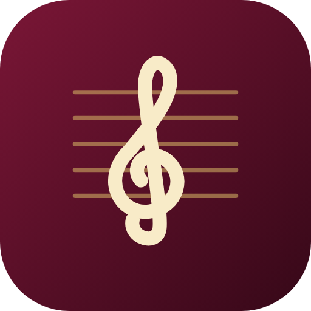
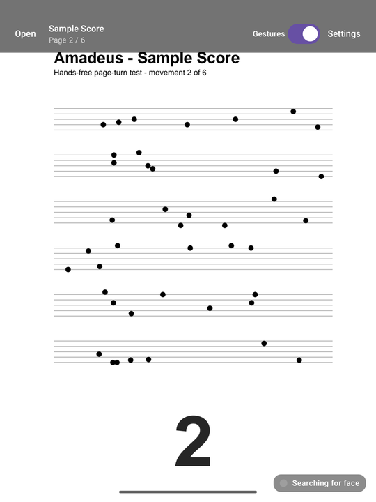
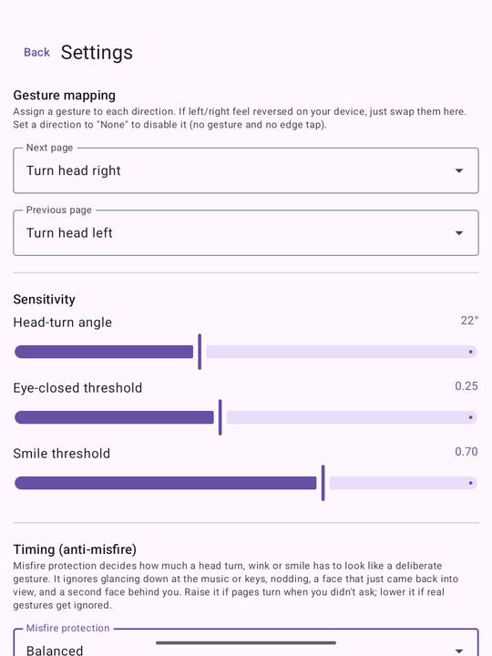

<p align="center"></p>

# Amadeus

A hands-free **sheet-music PDF reader** for Android, in the spirit of forScore. Open a
score, prop your tablet on the music stand, and turn pages with a **facial gesture**
(a head turn or a wink) so your hands never leave the instrument.

Face tracking runs **fully on-device and offline** via Google ML Kit's bundled model.
Amadeus doesn't request the Internet permission, so neither camera frames nor anything
else can leave the device.

<p align="center">
  
  
</p>

## Install

Download the latest `amadeus-<version>.apk` from
[Releases](https://github.com/joshuamontierth/amadeus/releases) and open it on your
Android tablet or phone (allow "install unknown apps" for your browser or file manager
when asked). Requires Android 8.0+ on an ARM device (all current phones and tablets) with
a front camera.

## Status

MVP. Open one PDF → render a page (tablet, portrait) → turn pages by gesture, tap, or
the bundled sample. Gesture mapping and sensitivity are fully configurable.
**Double-tap** the page for a clean, immersive full-screen view (hides Amadeus's
top controls and the Android system bars; the small gesture-status indicator stays
visible so you still see searching / ready / wait while reading. Double-tap to restore).

## How it works

```
CameraX (front, ImageAnalysis, no preview)
        │  frames
        ▼
FaceAnalyzer ── ML Kit FaceDetector ──► FaceSelection ──► FaceSignals(yaw, pitch, roll, eyes, smile)
        │
        ▼
GestureEngine (settle + gates + dwell + cooldown + re-arm state machine)
        │  PageAction.NEXT / PREVIOUS
        ▼
ReaderViewModel ──► PdfController (android.graphics.pdf.PdfRenderer) ──► page bitmap
        │
        ▼
ReaderScreen (Jetpack Compose): full-page view, status dot, tap zones, controls
```

- **Gestures** (`face/Gesture.kt`): `HEAD_LEFT/RIGHT` (head yaw), `WINK_LEFT/RIGHT`,
  `BLINK_BOTH` (long blink), `DOUBLE_BLINK` (two quick blinks), and `SMILE`. You assign
  any gesture to *Next* / *Previous* in Settings, so if left/right feel mirrored on your
  device you just swap them. Head turn, wink and smile are held poses (dwell timer);
  long blink and double blink are events from a debounced blink tracker.
- **Anti-misfire**: layered safeguards (sliders and a **Misfire protection** level in Settings,
  the rest built in):
  - **Dwell** for held poses: hold ~350 ms before firing. Only frames that actually show the
    pose count toward it, so a dropped frame pauses the hold rather than ending it, and a pose
    that wobbles around its threshold is kept once entered (it relaxes to 80% while held).
  - **Neutral first:** a gesture only counts after the face has been seen at rest for a moment
    (0.4 s on Balanced). A face that has just come into view, or comes back after you looked away
    or left the frame, never turns a page by already being turned.
  - **Square-on gate:** nothing counts while your head is pitched away from where it rests
    (glancing down at the keys or the music), tipped toward a shoulder, or nodding along to the
    beat. ML Kit's yaw and eye estimates are unreliable there. Eye and smile gestures also need
    the head roughly frontal (within 20° of rest).
  - **Adaptive rest pose:** your resting yaw and pitch follow slow drift in how you sit (a tablet
    standing off to one side), up to 10°, so gestures are measured from where your head rests.
    A deliberate turn is too fast and too large to be absorbed.
  - **Debounced blink tracking:** the eyes-closed state uses dual thresholds
    (hysteresis) and must persist ≥2 frames / 70 ms before it flips, so one noisy
    ML Kit frame can never fake, split, or end a blink.
  - **Long blink** has its own duration slider (default 700 ms): comfortably above
    natural blinks (~100–400 ms), which are classified separately and ignored. It needs eyes
    that were open first, and a closure that starts like a blink: eyelids that droop as your gaze
    drops to the keys or your lap never count.
  - **Double blink** = two crisp blinks (80–400 ms each) with a clean reopen between
    them, at most 450 ms apart, after ≥200 ms of open eyes, so rapid natural blink
    flutter can't chain into a trigger.
  - **One reader:** the largest face is the reader. A second face nearly as large (someone
    leaning in) or a face cut off by the edge of the frame pauses gestures until it clears.
  - **Cooldown + re-arm:** after a turn, new turns are blocked for ~1.2 s *and* the face must sit
    at rest again for a moment (0.25 s on Balanced), so a held pose can't page repeatedly and a
    head swinging back past centre doesn't turn the other way.
  - **Misfire protection** (Settings) scales the settling time, the tilt, roll and nod limits, the
    re-arm time and how large a second face may be: *Relaxed*, *Balanced* (default) or *Strict*.
- **Status dot** (bottom-right): grey = searching, green = ready, amber = holding,
  blue = cooldown or settling, red = camera permission needed. A small line shows live yaw / pitch /
  eye values to help you tune thresholds (and see when the head-pose gate is active).

## Project layout

| Path | What |
|---|---|
| `app/src/main/java/com/maestro/app/face/Gesture.kt` | Gesture model, `GestureConfig`, `MisfireProtection` |
| `…/face/GestureEngine.kt` | Frames → page turns: dwell, gates, rest pose, cooldown (pure logic) |
| `…/face/BlinkTracker.kt` | Debounced blink / double-blink / long-blink events (pure logic) |
| `…/face/FaceSelection.kt` | Picks the reader's face and rejects untrustworthy frames (pure logic) |
| `…/face/FaceAnalyzer.kt` | ML Kit analyzer → `FaceSignals` |
| `…/face/CameraGesture.kt` | Binds CameraX front camera while detection is active |
| `…/pdf/PdfController.kt` | `PdfRenderer` wrapper → page bitmaps |
| `…/settings/SettingsStore.kt` | DataStore-backed `GestureConfig` |
| `…/ReaderViewModel.kt` | App state: document, pages, detection, config |
| `…/ui/ReaderScreen.kt` | Reader UI |
| `…/ui/SettingsScreen.kt` | Gesture mapping + sensitivity |
| `app/src/test/java/.../face/` | Unit tests: scripted frame sequences for real gestures and false alarms |
| `app/src/main/assets/sample_score.pdf` | Bundled placeholder score for "Open sample" |

## Build

Requires JDK 17+ and the Android SDK (API 35). Point Gradle at the SDK with
`ANDROID_HOME` or a `local.properties` containing `sdk.dir=/path/to/Android/Sdk`
(Android Studio creates it for you).

```bash
./gradlew :app:assembleDebug        # build app/build/outputs/apk/debug/app-debug.apk
./gradlew :app:testDebugUnitTest    # run gesture-engine unit tests
./gradlew :app:lintDebug            # lint
```

Release builds (`./gradlew :app:assembleRelease`) are minified with R8 and include only
ARM libraries. They are signed with the key named in a `keystore.properties` file at the
repo root (`storeFile`, `storePassword`, `keyAlias`, `keyPassword`; not committed);
without one they fall back to the debug key.

## Run on a device

1. Enable **Developer options → USB debugging** on your Android tablet/phone and plug it in.
2. `adb devices` — confirm it shows up.
3. `adb install -r app/build/outputs/apk/debug/app-debug.apk`
4. Launch **Amadeus**, grant the camera permission, tap **Open sample score** (or open
   your own PDF), then use your chosen gesture to flip pages. Tune in **Settings**;
   double-tap the page for immersive full-screen.

Since winking and head-turning can be awkward, good comfortable pairings are
**Next = Smile / Previous = Long blink**, or **Next = Double blink / Previous = Smile**.

## License

[MIT](LICENSE). Face detection uses Google's
[ML Kit](https://developers.google.com/ml-kit), which is distributed under its own
[terms](https://developers.google.com/ml-kit/terms).
